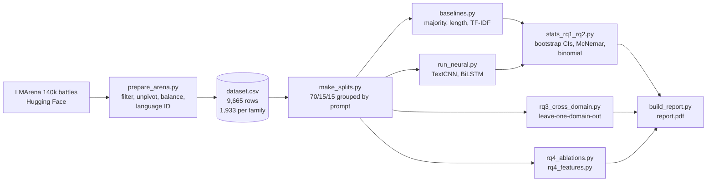

# Who Wrote It? Identifying LLMs from Their Responses

**Can a classifier tell which AI wrote a piece of text, even with the model's name scrubbed out?**
Yes. Across 9,665 real chatbot answers from five model families, a simple n-gram classifier picks the
right family **86%** of the time, against 20% chance. The fingerprint is mostly *how* a model writes
("Okay, here's…", "Let me know if…", "Certainly! Below is…"), plus its formatting habits.


**CMPSC 448 midterm project.**

**Team Members:**
- Atharva Herwade Patil (Team Leader) - (abh6244)
- Anuroop Saini - (abs7800)
📄 **Full report: [`report/report.pdf`](report/report.pdf)**

---

## Results at a glance

Test accuracy (%) with grouped-bootstrap 95% CIs (2,000 resamples of test prompts, 1,453 test rows).
Neural models are the mean ± std over 3 seeds. Chance is 20%.

| Method | Output only | Input only | Input + output |
|---|---|---|---|
| Majority class | 20.0 [18.3, 21.8] | 20.0 [18.3, 21.8] | 20.0 [18.3, 21.8] |
| Length-only LR | 41.4 [38.7, 43.9] | 20.7 [18.9, 22.4] | 39.2 [36.7, 41.7] |
| TF-IDF + LR | **86.3** [84.4, 88.2] | 21.9 [20.1, 23.8] | 85.1 [83.2, 87.1] |
| **TextCNN** | **79.6** ± 0.5 [77.8, 81.5] | 19.7 ± 2.0 [18.4, 21.0] | 80.8 ± 0.3 [78.8, 82.8] |
| **BiLSTM** | **75.6** ± 0.7 [73.6, 77.6] | 20.6 ± 0.2 [19.2, 22.1] | 75.0 ± 0.6 [73.0, 76.8] |

<sub>Sources: `results/comparison_ci.csv`, `results/comparison.csv`. Macro-F1 is in the same files.</sub>

| Question | Answer |
|---|---|
| **RQ1:** can we identify the model from its output? | **Yes.** TF-IDF 86.3%, TextCNN 79.6%, BiLSTM 75.6%. Both gaps are significant (McNemar p < 0.001 and p = 0.001). |
| **RQ2:** does the user's prompt help? | **No.** Prompt-only is at chance (no model significantly above 20%). Adding the prompt to the output gives no reliable gain. |
| **RQ3:** do fingerprints transfer to unseen domains? | **Mostly.** Leaving a domain out of training costs 1–9 points. Math is the hardest domain to transfer to; claude is the most stable family. |
| **RQ4:** what gives a model away? | **Mostly word choice, plus formatting.** Removing markdown hurts most among the text edits, and un-masking model names changes nothing. |

<table>
<tr>
<td width="50%"><br><sub>Most errors are openai ↔ qwen.</sub></td>
<td width="50%"><br><sub>Accuracy removed by each transformation (95% CIs).</sub></td>
</tr>
<tr>
<td width="50%"><br><sub>Accuracy drop when the test domain is unseen in training.</sub></td>
<td width="50%"><br><sub>Style features per family: length, markdown, emoji, refusals.</sub></td>
</tr>
</table>

## How it works



- **Data.** Each LMArena battle is one prompt answered by two anonymous, randomly paired models. Every battle
  becomes two rows, `(LLM_name, LLM_Input, LLM_output)`. Both sides are kept together where possible, so
  4,519 of the 4,978 prompts are answered by two or more families.
- **No shortcuts.**
  - Splits are grouped by `prompt_id`, so no prompt appears in two splits.
  - Model and company names are masked with `[MODEL]`.
  - A near-duplicate check found only 0.69% of test rows affected.
- **Models.**
  - **TextCNN** (Kim, 2014): 128-dimensional embeddings and 3/4/5-gram filters (100 each) with max-pooling.
  - **BiLSTM:** 2 layers with 128 hidden units per direction, mean-pooled over real tokens only.
  - **Training:** AdamW with early stopping on validation macro-F1, 3 seeds, deterministic cuDNN.

## Quickstart

```bash
git clone https://github.com/ath6244/scriptum.git
cd scriptum
python -m venv .venv
source .venv/bin/activate          # Windows: .venv\Scripts\activate
pip install -r requirements.txt    # for a CUDA build of PyTorch, install torch first (see requirements.txt)
```

All results and figures are already in `results/` and `figures/`, so you can read them without running
anything. The full dataset is **not** in the repo: build it first (it downloads ~1.6 GB from Hugging Face):

```bash
python scripts/prepare_arena.py    # -> dataset.csv (identical on every run, seed 448)
```

## Reproduce every result

Run the commands from the repo root, in order. Every script fixes its seeds and writes CSV/JSON to
`results/` and PNGs to `figures/`. The long scripts **skip runs that are already saved**, so they can be
restarted after an interruption.

| # | Command | What it produces | Time* |
|---|---|---|---|
| 1 | `python scripts/prepare_arena.py` | `dataset.csv`, dataset stats, filtering log | ~10 min |
| 2 | `python scripts/make_splits.py` | `splits.json`, masking and split stats | <1 min |
| 3 | `python scripts/baselines.py` | majority / length-only / TF-IDF results, TF-IDF confusion matrix | ~35 min |
| 4 | `python scripts/run_neural.py` | TextCNN + BiLSTM × 3 conditions × 3 seeds, curves, confusion matrices, comparison table | ~1.5 h (GPU) |
| 5 | `python scripts/stats_rq1_rq2.py` | per-row predictions, bootstrap CIs, McNemar, binomial tests, length quartiles | ~10 min |
| 6 | `python scripts/check_near_duplicates.py` | near-duplicate prompt check | <1 min |
| 7 | `python scripts/rq3_cross_domain.py` | RQ3 leave-one-domain-out results and heatmap | ~3 h |
| 8 | `python scripts/rq4_ablations.py --models tfidf_lr length_lr`<br>`python scripts/rq4_ablations.py --models textcnn` | RQ4 ablations (CPU part, then GPU part) | ~1 h + ~45 min |
| 9 | `python scripts/rq4_features.py` | style features and top words per family | ~5 min |
| 10 | `python scripts/scan_pii.py` | PII scan counts, the 50-row `data/sample.csv` | <1 min |
| 11 | `python scripts/build_report.py` | `report/report.pdf` (bundled pandoc + headless Chrome/Chromium/Edge) | <1 min |

<sub>*Measured on a 4 GB Quadro M2000M laptop GPU. The neural scripts fall back to the CPU (slowly) without CUDA.</sub>

**Recompute everything from scratch:** delete the saved results first, then run steps 1–11 in order:

```bash
rm -rf results figures splits.json
```

`prepare_arena.py` writes its own log. The other run logs in `results/` are console output, so capture
them while you run, for example `python scripts/run_neural.py | tee results/run_neural_log.txt`. Do the
same for `rq3_log.txt`, `rq4_tfidf_log.txt` and `rq4_textcnn_log.txt`.

## Data and license

- **Source:** [`lmarena-ai/arena-human-preference-140k`](https://huggingface.co/datasets/lmarena-ai/arena-human-preference-140k),
  anonymous side-by-side chatbot battles collected April–July 2025.
- **License:** prompts are **CC-BY-4.0**. Model outputs remain under **each provider's terms of use**
  (Anthropic, Google, Meta, OpenAI, Alibaba).
- **Privacy:**
  - The full `dataset.csv` is never committed. `prepare_arena.py` rebuilds it deterministically.
  - `data/sample.csv` is a 50-row preview (10 per family). It excludes every row in which `scan_pii.py`
    found an e-mail address, phone number or URL.
  - Committed logs and results contain counts, IDs and labels only, no dataset text.
- **Columns:** `LLM_name, LLM_Input, LLM_output, model_version, prompt_id, domain, source_id`. The models read
  `LLM_output_masked`, which `src/data.py` builds by replacing 16 model and company names with `[MODEL]`.

## Repository layout

```
scriptum/
├── src/
│   ├── data.py           load data, masking, grouped splits, tokenizer and vocabulary
│   ├── models.py         TextCNN and BiLSTM (PyTorch)
│   ├── train.py          seeding, batching, training loop with early stopping
│   ├── stats.py          accuracy / macro-F1, grouped bootstrap, McNemar, binomial test
│   └── transforms.py     RQ4 text transformations and style features
├── scripts/              one script per step in the table above
├── results/              every number in the report (CSV + run logs)
│   └── preds/            per-row test predictions (row index + labels only)
├── figures/              every figure in the report
├── report/
│   ├── report.md         report source (each number cites its results file in a comment)
│   ├── report.pdf        the submitted report
│   └── style.css         print style used by build_report.py
├── data/sample.csv       PII-free 50-row preview of the dataset
├── splits.json           train / val / test prompt_ids
└── requirements.txt      pinned dependencies
```
