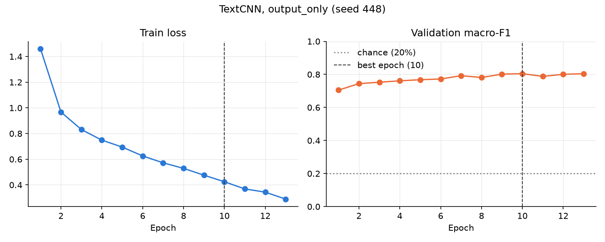
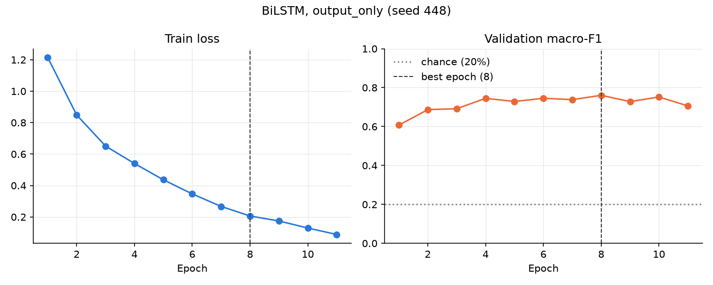
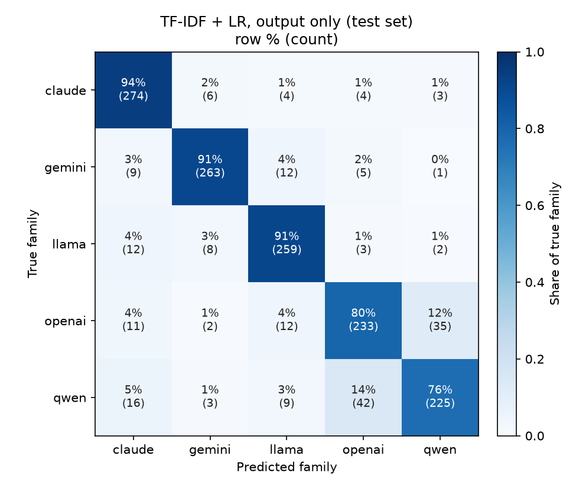
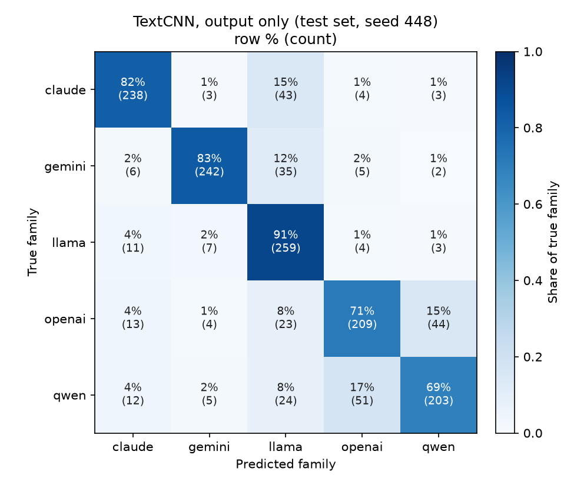
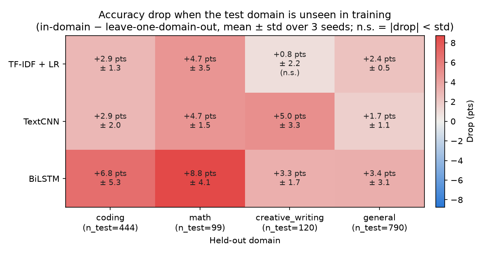
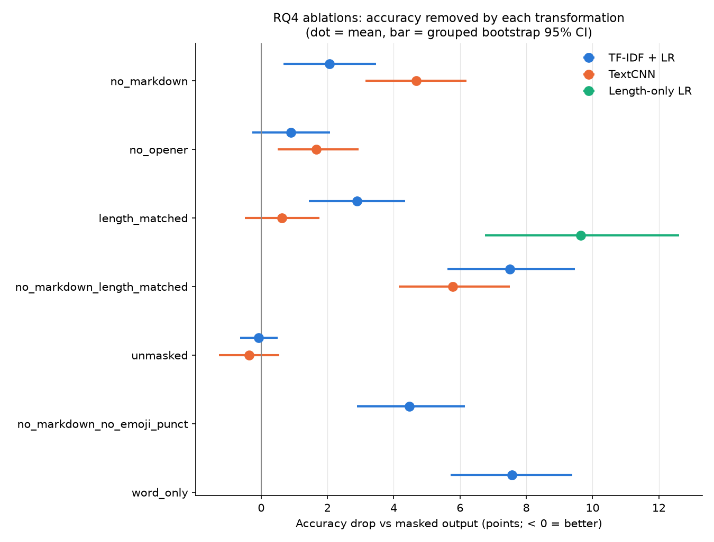
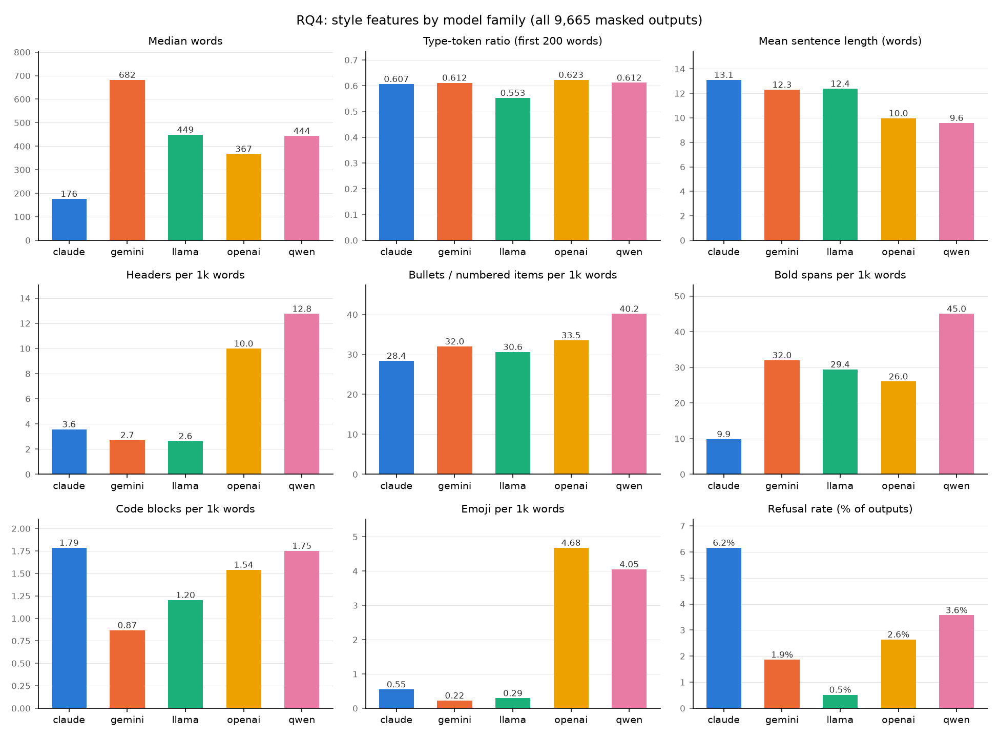

<!--
Every number in this report comes from a file under results/ (or splits.json); a comment after each
paragraph or table names the file. Figures are in ../figures/. Section 5 (Lessons) was written by the authors.
-->

# 1 Problem & Dataset

## 1.1 Problem definition

**Task.** This is a 5-way text classification task. Each example is a triple **(LLM_name, LLM_Input, LLM_output)**,
which we write as $(y, p, o)$:

- $y \in \mathcal{Y} = \{\text{claude}, \text{gemini}, \text{llama}, \text{openai}, \text{qwen}\}$ is the model family (the class label),
- $p$ is the user's prompt,
- $o$ is the model's response.

We learn a classifier $f : x \mapsto \hat{y} \in \mathcal{Y}$ for three choices of input $x$: the output only
($x = o$), the input only ($x = p$), or both ($x = (p, o)$). Model and company names in $o$ are masked
(Section 1.7). The classes are exactly balanced, so **chance accuracy is 20%**.

**Evaluation.** On a held-out test set of $n$ rows, we report:

- **Accuracy**: $\frac{1}{n}\sum_i \mathbb{1}[\hat{y}_i = y_i]$.
- **Macro-F1**: the unweighted mean of the five per-family F1 scores, $\frac{1}{5}\sum_{c \in \mathcal{Y}} F1_c$.

Neural results are the mean ± std over 3 seeds. Uncertainty is a 95% confidence interval from a **grouped
bootstrap** that resamples test prompts. Two models are compared on the same test rows with the **exact
McNemar test**, and an accuracy is compared with chance using an **exact binomial test** (details in
Section 2.6).

**Research questions.**

- **RQ1:** can the family be identified from the output?
- **RQ2:** does the prompt help?
- **RQ3** (extra credit): do the fingerprints transfer across task domains?
- **RQ4** (extra credit): which characteristics distinguish the families?

## 1.2 Source and license

The data come from LMArena's public **arena-human-preference-140k** dataset on Hugging Face [2]. Each record
is an anonymous "battle": one user prompt answered by two randomly paired models side by side, collected
April–July 2025 on the Chatbot Arena platform [1]. The prompts are released under CC-BY-4.0; the model outputs remain under each provider's
terms of use. We did not query any model ourselves.

**Personal information.** We scanned all 9,665 prompts and outputs:

- **Prompts:** no e-mail addresses and no phone numbers. 10 prompts contain file paths with a username
  (e.g. `/home/<user>/`).
- **Outputs:** 65 contain an e-mail address, but most are placeholders such as `john@example.com`. Only 24 have
  a non-placeholder domain, and these are mostly public organizations or example servers. 13 contain a phone
  number, mostly public hotlines and business lines.
- **Repository:** the full dataset is not committed; it is regenerated from the public source. The committed
  50-row sample excludes every row flagged by any detector.

<!-- source: results/pii_scan.csv -->

## 1.3 Construction and filtering

All steps are in `scripts/prepare_arena.py` (seed 448), and each one is logged.

| Step | Why | Result |
|---|---|---|
| Read all battles | | 135,634 battles |
| `language == "en"` and first battle of the session | English only; later battles in a session depend on earlier context | 57,759 battles |
| Exactly one user turn and one assistant turn on both sides, text only (battles with images removed) | The text prompt must be everything the model saw | 49,166 battles |
| Unpivot: one row per side | Each row is one (input, model, output) | 98,332 rows |
| Map `model_version` to family by explicit prefix rules (e.g. `gpt*`, `o3*` → openai; `gemini*` but not `gemma*` → gemini); drop unmapped models | Family is the class label | 78,762 rows |
| Drop empty prompts and outputs under 5 words | Almost no stylistic signal | 78,282 rows |
| Keep the 5 largest families, sample 2,000 each; keep both sides of a battle together when they come from two different kept families | Balance, and the same prompt answered by two families, so the prompt cannot reveal the label | 10,000 rows |
| Drop outputs that langdetect does not identify as English (code-only outputs kept) | The `language` tag describes the prompt; 318 outputs were in another language | 9,682 rows |
| Downsample every family to the smallest count, keeping battle pairs first | Exact balance | **9,665 rows (1,933 per family)** |

<!-- source: results/prepare_arena_log.txt (battle and row counts); results/language_filter.csv (318 = 60+67+63+67+61 dropped, 9,682 after the filter, 1,933 final) -->

In the final data, 4,594 battles keep both sides, and **4,519 of the 4,978 distinct prompts are answered by two
or more families**.

<!-- source: results/prepare_arena_log.txt -->

## 1.4 Schema

`dataset.csv` has the three required columns first, followed by four helper columns:

| Column | Meaning |
|---|---|
| `LLM_name` | Family = class label (claude, gemini, llama, openai, qwen) |
| `LLM_Input` | The user's prompt |
| `LLM_output` | The model's response |
| `model_version` | Exact Arena model name, e.g. `claude-3-5-sonnet-20241022` |
| `prompt_id` | Short SHA-1 hash of `LLM_Input`; identical prompts share an id |
| `domain` | coding, math, creative_writing or general, from Arena's `is_code` and category tags |
| `source_id` | Arena battle id |

## 1.5 Balance and composition

| Family | Rows | Mean words | Median words | Coding | Creative writing | General | Math | Most common version (share) |
|---|---|---|---|---|---|---|---|---|
| claude | 1,933 | 229.4 | 176 | 577 | 160 | 1,087 | 109 | claude-opus-4-20250514 (18.4%) |
| gemini | 1,933 | 760.6 | 682 | 591 | 175 | 1,036 | 131 | gemini-2.5-flash (23.4%) |
| llama | 1,933 | 471.8 | 449 | 600 | 152 | 1,033 | 148 | llama-4-maverick-17b-128e-instruct (30.7%) |
| openai | 1,933 | 426.4 | 367 | 623 | 158 | 1,028 | 124 | chatgpt-4o-latest-20250326 (20.3%) |
| qwen | 1,933 | 460.3 | 444 | 581 | 152 | 1,082 | 118 | qwen3-235b-a22b-no-thinking (30.0%) |

<!-- source: results/data_stats.csv (rows, words, domain counts); results/top_model_version.csv (most common version) -->

Each family mixes several model versions: 8 each for claude, gemini and openai, 6 for qwen and 4 for llama.
No single version makes up more than 31% of its family.

<!-- source: results/model_composition.csv, results/top_model_version.csv -->

## 1.6 Splits

We split **by prompt**, not by row: every row with the same `prompt_id` goes to the same split. This way a
classifier is never tested on a prompt it saw in training. The split is 70/15/15, stratified by domain, with
seed 448. That gives 3,484 / 747 / 747 prompts and 6,754 / 1,458 / 1,453 rows for train / val / test, with
about 290 test rows per family.

<!-- source: splits.json (prompt counts); results/split_counts.csv (rows per split, family and domain) -->

As a check for near-duplicates, we normalized every prompt (lowercase, punctuation and whitespace removed)
and re-hashed it. Only 11 normalized groups span more than one split, covering 10 test rows (0.7%). These are
trivial prompts such as "how many r's are in strawberry", so we did not re-split.

<!-- source: results/near_duplicates.csv, results/near_duplicate_groups.csv -->

## 1.7 Masking self-identification

Some outputs name their own model or company (e.g. "I'm Meta AI"). We replace whole-word, case-insensitive
mentions of 16 model and company names (Claude, Anthropic, GPT, ChatGPT, OpenAI, o3, o4, Gemini, Bard, Google,
DeepMind, Qwen, Alibaba, Tongyi, Llama, Meta) with `[MODEL]`. This changes 10.1–14.1% of outputs per family.
**All experiments use the masked output** (`LLM_output_masked`) unless stated otherwise.

<!-- source: results/masking_stats.csv; per-name counts in results/masking_name_hits.csv -->

## 1.8 Known limitations

- **Time drift.** Which models were live on the Arena changed between April and July 2025, so family can
  correlate with when a prompt was asked.
- **Mixed versions.** Each family mixes several model versions, including "thinking" variants, so a
  family-level fingerprint is an average over them.
- **English only.** Only English prompts and outputs are included.
- **Prompt choice.** Arena prompts are whatever users chose to type: many are short, and some repeat
  (e.g. letter-counting questions).
- **Length differences.** Families differ strongly in output length: median 176 words for claude vs 682 for
  gemini (see Section 3.3).

<!-- source: results/data_stats.csv -->

# 2 Models & Training

## 2.1 Input representation

The tokenizer lowercases the text and splits it into words and single punctuation characters. Markdown
symbols such as `#`, `*`, `-` and the backtick therefore stay as separate tokens, because formatting may be
part of a family's fingerprint. The vocabulary is built from the **training split only**, keeping tokens seen
at least twice, plus `<pad>`, `<unk>` and `[SEP]`. This gives 57,838 entries. Sequences are cut to 512 tokens,
keeping the beginning; 57% of training outputs are longer than that. In the input + output condition, the
prompt gets at most 128 tokens, followed by `[SEP]` and then the output.

<!-- source: results/run_neural_log.txt ("Vocab size", "hit the 512 cap") -->

We compare three input conditions:

- (a) **output only**: `LLM_output_masked`
- (b) **input only**: `LLM_Input`
- (c) **input + output**: `LLM_Input [SEP] LLM_output_masked`

## 2.2 TextCNN

Following Kim [3], tokens are embedded in 128 dimensions. One-dimensional convolutions with widths 3, 4 and 5
(100 filters each) slide over the sequence, so each filter detects a short n-gram pattern. After a ReLU,
max-pooling over time keeps each filter's strongest response anywhere in the text. The resulting 300 features
pass through dropout (0.5) and a linear layer to the 5 classes. The model has 7.56M parameters, almost all of
them in the embedding table.

<!-- source: results/neural_summary.csv (params) -->

## 2.3 BiLSTM

The BiLSTM uses the same 128-dimensional embeddings, followed by a 2-layer bidirectional LSTM [4] with 128
hidden units per direction and dropout 0.3 between the layers. Sequences are packed, so the LSTM never reads
padding. The 256-dimensional outputs are **mean-pooled over real tokens only**, using the sequence lengths,
then passed through dropout (0.3) and a linear layer. The model has 8.06M parameters.

<!-- source: results/neural_summary.csv (params) -->

## 2.4 Training

Both models are trained with:

- the AdamW optimizer [5] (learning rate 10⁻³, weight decay 10⁻⁴)
- batch size 64 and cross-entropy loss
- gradient-norm clipping at 1.0
- early stopping on validation macro-F1 (patience 3, at most 20 epochs); the best checkpoint is restored before testing

Each configuration runs with seeds 448, 449 and 450, which fix Python, NumPy and PyTorch (with deterministic
cuDNN). Training ran on a 4 GB Quadro M2000M GPU. On average the best epoch was 12.7 for TextCNN and 7.3 for
BiLSTM (output only); one output-only run took about 3 minutes for TextCNN and about 6 minutes for BiLSTM.

<!-- source: results/neural_summary.csv (best_epoch_mean, train_time_s_mean) -->

The training curves (Figure 1) show the BiLSTM fitting the training set quickly: its training loss keeps
falling while validation macro-F1 levels off after a few epochs, which is where early stopping helps.

## 2.5 Baselines

1. **Majority class.**
2. **Length-only logistic regression** on four log-scaled lengths: characters, words, lines and newlines.
3. **TF-IDF + logistic regression** on word 1–2-grams plus character 3–5-grams (up to 100k features each,
   minimum document frequency 2, sublinear TF).

For both regression baselines, the regularization strength C is chosen on the validation set from
{0.01, 0.1, 1, 10, 100} by macro-F1. The baselines are deterministic on fixed splits, so their three seeds
give identical results.

## 2.6 Evaluation

We report test **accuracy** and **macro-F1**: the mean over the 3 seeds, the standard deviation over seeds, and
a 95% confidence interval from a **grouped bootstrap** (2,000 resamples of test *prompts*, so the two rows that
share a prompt are resampled together) [7].

To compare two models on the same test rows, we use the **exact McNemar test** [6] on seed 448. To compare an
accuracy against chance, we use an **exact binomial test** against p = 0.20. Both tests treat rows as
independent, but some test rows share a prompt, so their p-values are approximate. The grouped bootstrap
does not have this problem.

# 3 Results

## 3.1 RQ1: can we identify which LLM generated a response?

**Yes, well above chance.** Table 1 shows the output-only results.

| Method | Accuracy (%) | 95% CI | Macro-F1 | 95% CI |
|---|---|---|---|---|
| Majority | 20.0 | [18.3, 21.8] | 0.067 | [0.062, 0.072] |
| Length-only LR | 41.4 | [38.7, 43.9] | 0.399 | [0.373, 0.424] |
| TF-IDF + LR | **86.3** | [84.4, 88.2] | **0.862** | [0.843, 0.881] |
| TextCNN | 79.6 ± 0.5 | [77.8, 81.5] | 0.796 ± 0.004 | [0.777, 0.814] |
| BiLSTM | 75.6 ± 0.7 | [73.6, 77.6] | 0.757 ± 0.006 | [0.736, 0.776] |

*Table 1. Output only, test set (1,453 rows). ± is the std over 3 seeds; CI from the grouped bootstrap. Chance = 20%.*

<!-- source: results/comparison_ci.csv (means and CIs); results/comparison.csv (seed std) -->

Both required neural models are far above chance. TextCNN reaches 79.6% and BiLSTM 75.6%, and their
confidence intervals do not overlap with each other or with chance.

The ranking is **TF-IDF + LR > TextCNN > BiLSTM**, and McNemar tests on the same test rows (seed 448)
confirm both gaps:

| Comparison | Only the first is right | Only the second is right | p-value |
|---|---|---|---|
| TF-IDF vs TextCNN | 162 rows | 59 rows | < 0.001 |
| TextCNN vs BiLSTM | 166 rows | 111 rows | 0.001 |

<!-- source: results/mcnemar.csv -->

A linear model on sparse n-grams beats both neural models here. A likely reason is the data size: with about
6.8k training texts, an embedding table of 7.4M parameters (57,838 × 128) learned from scratch is harder to fit than
regularized n-gram weights. Also, TF-IDF sees the whole text, while the neural models see only the first 512
tokens, and 57% of outputs are longer than that.

<!-- source: results/split_counts.csv (6,754 train rows); results/neural_summary.csv (params); results/run_neural_log.txt (57% truncated) -->

Errors are not spread evenly across families. With TF-IDF, per-family recall is:

| Family | claude | gemini | llama | openai | qwen |
|---|---|---|---|---|---|
| Recall | 94.2% (274/291) | 90.7% (263/290) | 91.2% (259/284) | 79.5% (233/293) | 76.3% (225/295) |

Most remaining errors are **openai and qwen mistaken for each other**: 35 openai outputs were predicted as
qwen, and 42 qwen outputs as openai (Figure 2). The neural confusion matrices show the same pattern
(Figure 3).

<!-- source: results/confusion_tfidf_output.csv -->

## 3.2 RQ2: does the user's prompt help identify the LLM?

| Method | Output only | Input only | Input + output |
|---|---|---|---|
| Majority | 20.0 [18.3, 21.8] | 20.0 [18.3, 21.8] | 20.0 [18.3, 21.8] |
| Length-only LR | 41.4 [38.7, 43.9] | 20.7 [18.9, 22.4] | 39.2 [36.7, 41.7] |
| TF-IDF + LR | 86.3 [84.4, 88.2] | 21.9 [20.1, 23.8] | 85.1 [83.2, 87.1] |
| TextCNN | 79.6 ± 0.5 [77.8, 81.5] | 19.7 ± 2.0 [18.4, 21.0] | 80.8 ± 0.3 [78.8, 82.8] |
| BiLSTM | 75.6 ± 0.7 [73.6, 77.6] | 20.6 ± 0.2 [19.2, 22.1] | 75.0 ± 0.6 [73.0, 76.8] |

*Table 2. Test accuracy (%) for each input condition: mean ± seed std, [grouped-bootstrap 95% CI]. Macro-F1 CIs are in results/comparison_ci.csv.*

<!-- source: results/comparison_ci.csv; results/comparison.csv (seed std) -->

**(i) Can the family be predicted from the prompt alone?** No. Every input-only model is at about chance
(19.7–21.9%). Every input-only confidence interval includes 20% except TF-IDF's, whose interval [20.1, 23.8]
only just excludes it, and its exact binomial test is not significant (21.9%, p = 0.077). In the binomial
tests, no model is significantly *above* chance. One TextCNN seed (448) is
significantly *below* chance (17.8%, p = 0.039): its predictions are skewed toward some families. That is a
bias, not information about the family, and it is 1 of 9 tests.

<!-- source: results/binomial_input_only.csv -->

**(ii) Does adding the prompt improve classification?** We find no reliable improvement:

- **TF-IDF:** 85.1% with the prompt vs 86.3% without; the confidence intervals overlap almost entirely.
- **BiLSTM:** 75.0% vs 75.6%; McNemar p = 0.24.
- **TextCNN:** the only possible gain, 80.8% vs 79.6% (+1.2 points). This is larger than the seed std, but
  McNemar is not significant (88 vs 63 rows, p = 0.050) and the confidence intervals overlap. So any benefit
  is small and uncertain.

<!-- source: results/comparison_ci.csv; results/mcnemar.csv -->

**(iii) Why is input-only at chance here, and why might it work elsewhere?** The cause is how the Arena
collects its data: models are assigned to prompts largely at random, rather than users choosing a model for
a task, so the prompt carries almost no information about which family answered it. In our data, this shows
up as prompts that appear with answers from different families: because we kept both sides of a battle
whenever possible, 4,519 of the 4,978 prompts were answered by two or more families. In datasets where each prompt is answered by only one model,
or where users pick models by task (e.g. coding prompts sent to a coding model), input-only accuracy could be
well above chance. It would then measure *who asks what*, not how a model writes. Time drift (Section 1.8) is
the one route by which prompts could still carry a weak signal here. Our results show at most a very small
one: TF-IDF's input-only accuracy is +1.9 points above chance and not significant in the binomial test.

<!-- source: results/prepare_arena_log.txt -->

## 3.3 Output length

Length alone carries real signal: the length-only baseline reaches 41.4%, about twice chance. But that is
less than half of TF-IDF's 86.3%: measured above chance, length gets about +21 points and TF-IDF about +66.
So length is far from the whole fingerprint.

<!-- source: results/comparison_ci.csv -->

Do the models only succeed on very short or very long outputs? Table 3 splits the test set into quartiles of
output length. Accuracy rises from the shortest to the longest quartile for every text model, but the family
mix also changes sharply across quartiles: 44% of the shortest quartile is claude, and 44% of the longest is
gemini. To separate the two effects, we report two extra numbers per quartile:

- **Balanced accuracy:** the mean per-family recall, which the family mix cannot affect.
- **Accuracy expected from the mix:** the accuracy if each family kept its overall recall and only the
  family mix changed.

| Quartile (words) | Share claude / gemini | TextCNN acc / balanced / from mix | BiLSTM acc / balanced / from mix | TF-IDF acc / balanced / from mix | Length-LR acc / balanced |
|---|---|---|---|---|---|
| Q1 (5–194) | 44% / 9% | 73.4 / 67.0 / 79.5 | 69.2 / 63.8 / 75.4 | 79.1 / 71.6 / 87.8 | 38.9 / 21.2 |
| Q2 (195–395) | 25% / 11% | 74.9 / 75.3 / 78.7 | 73.4 / 74.0 / 74.7 | 83.6 / 83.0 / 85.9 | 39.0 / 34.9 |
| Q3 (396–630) | 6% / 17% | 82.8 / 80.2 / 78.9 | 77.9 / 75.2 / 74.9 | 89.6 / 89.6 / 84.8 | 39.9 / 34.9 |
| Q4 (633–5,705) | 5% / 44% | 87.5 / 83.6 / 81.5 | 82.1 / 77.8 / 77.7 | 93.1 / 89.5 / 86.8 | 47.8 / 27.2 |

*Table 3. Test accuracy (%) per output-length quartile. Neural values are the mean over 3 seeds.*

<!-- source: results/length_quartiles.csv -->

For the three text models, the family mix alone predicts an almost **flat** line (e.g. 79.5 → 81.5 for
TextCNN). Yet balanced accuracy still rises by 14–18 points from Q1 to Q4. **The trend survives after
accounting for the family mix:** longer outputs carry more evidence and are genuinely easier to attribute,
and the models are not just succeeding on the extremes. Even the shortest quartile is well above chance:
balanced accuracy is 64–72% for the text models.

The length-only baseline behaves differently. Its balanced accuracy is not monotonic (21% → 35% → 35% →
27%), so its higher raw accuracy in Q4 mostly reflects which families are long, not a general effect.

<!-- source: results/length_quartiles.csv; per-seed values in results/acc_by_length.csv -->

# 4 Analyses

## 4.1 RQ3: do LLM fingerprints generalize across domains?

**Setup.** We use leave-one-domain-out (LODO) evaluation on output-only text, with the same three models and
hyperparameters as before. For each domain D (coding, math, creative writing, general), we train on the other
three domains and test on D. The test set is always the rows of D in the original test split; training and
validation rows come from the original train and validation splits, so the prompt grouping is unchanged.

For comparison, the **in-domain** condition trains on all four domains and tests on exactly the same rows of
D. The only difference between the two conditions is whether D was seen in training.

To make the training sets equal in size, every one of them is subsampled to **593 rows per family (2,965 rows
in total)**, the smallest per-family count over the four LODO folds. Which rows are drawn depends on the seed,
and each condition runs with seeds 448–450. TF-IDF + LR therefore also gets a seed standard deviation here.

**Because RQ3 trains on 593 rows per family instead of the full ~1,350, its absolute accuracies are lower
than in RQ1**, especially for the BiLSTM. Only the *difference* between the in-domain and LODO conditions is
interpreted here.

<!-- source: results/rq3_log.txt ("Size control: every training set = 593 rows per family (2965 total)"); results/rq3.csv (n_train = 2965); results/split_counts.csv (full training set) -->

| Model | Held-out domain (test rows) | In-domain acc. | LODO acc. | Drop, acc. (pts) | Drop, macro-F1 (pts) |
|---|---|---|---|---|---|
| TF-IDF + LR | coding (444) | 86.6 ± 0.9 | 83.7 ± 0.3 | 2.9 ± 1.3 | 3.0 ± 1.3 |
| | math (99) | 80.5 ± 2.1 | 75.8 ± 1.8 | 4.7 ± 3.5 | 5.0 ± 4.5 |
| | creative writing (120) | 75.6 ± 2.6 | 74.7 ± 1.3 | 0.8 ± 2.2 *(n.s.)* | 1.2 ± 2.0 *(n.s.)* |
| | general (790) | 82.5 ± 0.6 | 80.2 ± 0.2 | 2.4 ± 0.5 | 2.5 ± 0.5 |
| TextCNN | coding (444) | 77.9 ± 2.0 | 75.0 ± 0.4 | 2.9 ± 2.0 | 3.0 ± 1.6 |
| | math (99) | 72.4 ± 1.5 | 67.7 ± 0.0 | 4.7 ± 1.5 | 5.4 ± 2.0 |
| | creative writing (120) | 68.9 ± 2.9 | 63.9 ± 5.3 | 5.0 ± 3.3 | 5.5 ± 4.0 |
| | general (790) | 78.5 ± 0.7 | 76.8 ± 0.6 | 1.7 ± 1.1 | 1.8 ± 1.2 |
| BiLSTM | coding (444) | 68.0 ± 1.6 | 61.3 ± 4.3 | 6.8 ± 5.3 | 6.6 ± 5.4 |
| | math (99) | 71.4 ± 2.1 | 62.6 ± 2.7 | 8.8 ± 4.1 | 8.6 ± 2.6 |
| | creative writing (120) | 63.6 ± 2.1 | 60.3 ± 3.8 | 3.3 ± 1.7 | 4.1 ± 2.6 |
| | general (790) | 69.8 ± 1.0 | 66.4 ± 2.2 | 3.4 ± 3.1 | 3.6 ± 3.2 |

*Table 4. RQ3, output only, size-controlled. Values are mean ± std over 3 seeds, in %. Drop = in-domain − LODO,
paired by seed. n.s. = the drop is smaller than its std, so it is not meaningful.*

<!-- source: results/rq3_summary.csv (drop_*_meaningful flags); per-run values in results/rq3.csv -->

**Findings.**

- **Every domain is still identified well above chance when it was never seen in training.** The lowest LODO
  accuracy is 60.3% (BiLSTM, creative writing), against 20% chance.
- **The drops are a few points.** The average drop over the four domains is 2.7 points for TF-IDF, 3.6 for
  TextCNN and 5.6 for the BiLSTM. Measured above chance, the models keep 83%–98% of their in-domain
  accuracy, computed as (LODO − 20) / (in-domain − 20).
- **Only one drop is smaller than its std:** TF-IDF on creative writing (0.8 ± 2.2). Some others pass the rule
  only narrowly, such as BiLSTM coding (6.8 ± 5.3) and BiLSTM general (3.4 ± 3.1). With only 3 seeds, the std
  is itself uncertain, so these drops are probably real but their size is not precise.
- **Math is the hardest domain to *generalize to*.** It has the largest drop for TF-IDF (4.7) and the BiLSTM
  (8.8), and almost the largest for TextCNN (4.7, vs 5.0 for creative writing). It also has the fewest test
  rows (99), so these estimates are the least precise.
- **Creative writing is the hardest domain overall:** it has the lowest accuracy even in-domain
  (63.6–75.6%).

<!-- source: results/rq3_summary.csv; averages and "share kept" computed from the per-domain means in results/rq3.csv -->

**Per-family stability.** Table 5 shows how much each family's recall drops when its domain is unseen. Cells
marked † have fewer than 30 test rows for that family, so they are unreliable.

| Family / model | Coding | Math † | Creative writing † | General |
|---|---|---|---|---|
| claude / TF-IDF | 2.7 | 7.8 † | −1.2 † | −1.7 |
| claude / TextCNN | 0.4 | 11.8 † | 4.8 † | 4.2 |
| claude / BiLSTM | 0.0 | −5.9 † | −7.1 † | 0.2 |
| gemini / TF-IDF | 1.2 | 14.0 † | −2.6 † | 4.2 |
| gemini / TextCNN | −2.3 | 3.5 † | 5.1 † | 0.0 |
| gemini / BiLSTM | 11.6 | 22.8 † | 19.2 † | 14.7 |
| llama / TF-IDF | 3.7 | −3.8 † | 1.4 † | 0.0 |
| llama / TextCNN | 18.3 | −1.3 † | 12.5 † | 0.9 |
| llama / BiLSTM | −4.5 | 10.3 † | 4.2 † | −8.3 |
| openai / TF-IDF | −1.0 | 10.0 † | −3.2 † | 7.5 |
| openai / TextCNN | 9.6 | 13.3 † | −4.8 † | −3.2 |
| openai / BiLSTM | 9.6 | 11.7 † | 1.6 † | 7.1 |
| qwen / TF-IDF | 8.3 | −2.0 † | 11.1 † | 1.8 |
| qwen / TextCNN | −10.5 | −2.0 † | 6.4 † | 6.3 |
| qwen / BiLSTM | 15.6 | 2.0 † | −1.6 † | 3.0 |

*Table 5. Recall drop (in-domain − LODO, percentage points, mean over 3 seeds). Negative = the family is
recognized **better** when its domain is unseen. † = low n (fewer than 30 test rows per family: math has
17–26 and creative writing 21–28; coding and general have 82–165).*

<!-- source: results/rq3_per_family.csv (columns drop, n_test, low_n) -->

- **claude is the most consistently identifiable family.** On the two reliable domains (coding and general),
  its recall changes by at most 4.2 points for every model.
- **openai and qwen are the least stable.** Each has a drop of at least 7 points in a reliable domain for
  most models, for example openai 9.6 (coding) for both neural models and qwen 15.6 (coding) for the BiLSTM.
  These are also the two families most often confused with each other in RQ1.
- **gemini depends on the model.** It is stable for TF-IDF and TextCNN, but drops 11.6–14.7 points on the
  reliable domains for the BiLSTM.
- **Per-family numbers are noisy.** Their seed std is often 5–15 points (see the CSV), so only large,
  consistent differences should be read into this table.

<!-- source: results/rq3_per_family.csv (recall_*_std columns) -->

**Interpretation (hypothesis).** The evidence points mostly to a **general fingerprint, with a smaller
domain-specific part**: drops are small relative to the margin above chance, and they appear in every model.
**Hypothesis (a):** the BiLSTM loses the most (5.6 points on average) because it learns more topic- or
content-specific patterns, which do not carry over to a new domain. We did not test this directly. Its lower
in-domain accuracy and higher variance across seeds could also explain part of the larger drops, so we do not
claim it as proven.

## 4.2 RQ4: what characteristics distinguish the families?

### Ablations: what happens when a signal is removed?

We retrain on transformed versions of the masked output; train, validation and test are always transformed
the same way. The transformations are:

- **no_markdown:** removes headers, bold and italics, bullet and numbered-list markers, code fences, tables
  and horizontal rules.
- **no_opener:** drops the first sentence. This leaves 1.3% of training outputs empty.
- **length_matched:** cuts every output to 188 words, the dataset's 25th-percentile length.
- **no_markdown + length_matched:** both of the above.
- **unmasked:** uses the original output, with model and company names *not* masked.

For TF-IDF only, we also run **no_markdown + no emoji/punctuation** (emoji removed; dashes, curly quotes,
ellipses, repeated punctuation and whitespace normalized) and **word_only** (no character n-grams). To see how
much length signal survives truncation, we also run the length-only baseline on the length-matched text.

TextCNN runs 3 seeds. TF-IDF and length-only LR are deterministic, so they run once. Every drop is compared
with the main masked result on the same test rows, with a paired, grouped-bootstrap 95% CI.

<!-- source: results/rq4_tfidf_log.txt and results/rq4_textcnn_log.txt ("cuts every output to 188 words", "leaves 1.3% of train outputs empty") -->

| Variant | TF-IDF acc. [95% CI] | TF-IDF drop [95% CI] | TextCNN acc. [95% CI] | TextCNN drop [95% CI] |
|---|---|---|---|---|
| masked (reference) | 86.3 [84.4, 88.2] | — | 79.6 [77.8, 81.5] | — |
| no_markdown | 84.2 [82.2, 86.2] | **2.1 [0.7, 3.5]** | 75.0 [73.0, 76.9] | **4.7 [3.2, 6.2]** |
| no_opener | 85.4 [83.5, 87.3] | 0.9 [−0.3, 2.1] *(CI incl. 0)* | 78.0 [75.9, 79.9] | **1.7 [0.5, 2.9]** |
| length_matched | 83.4 [81.4, 85.3] | **2.9 [1.4, 4.4]** | 79.0 [77.1, 80.9] | 0.6 [−0.5, 1.8] *(CI incl. 0)* |
| no_markdown + length_matched | 78.8 [76.6, 80.9] | **7.5 [5.6, 9.5]** | 73.8 [71.8, 75.8] | **5.8 [4.2, 7.5]** |
| unmasked | 86.4 [84.5, 88.3] | −0.1 [−0.6, 0.5] *(CI incl. 0)* | 80.0 [78.1, 81.8] | −0.4 [−1.3, 0.6] *(CI incl. 0)* |
| no_markdown + no emoji/punct. | 81.8 [79.7, 83.8] | **4.5 [2.9, 6.2]** | — | — |
| word_only (no char n-grams) | 78.7 [76.5, 80.9] | **7.6 [5.7, 9.4]** | — | — |

*Table 6. RQ4 ablations, output only, test accuracy in %. Drop = masked − variant, in points; bold = the 95% CI
excludes 0. The length-only baseline falls from 41.4 [38.7, 43.9] to 31.7 [29.4, 34.0] on length-matched
text, a drop of 9.6 [6.8, 12.6].*

<!-- source: results/rq4_ablations.csv (per-run values in results/rq4_runs.csv) -->

### Descriptive features

| Family | Median words | TTR (first 200 words) | Mean sentence length | Headers / 1k words | Bullets / 1k | Bold / 1k | Code blocks / 1k | Emoji / 1k (% of outputs with emoji) | Refusal rate |
|---|---|---|---|---|---|---|---|---|---|
| claude | 176 | 0.607 (n = 785) | 13.1 | 3.6 | 28.4 | 9.9 | 1.79 | 0.55 (1.6%) | 6.2% |
| gemini | 682 | 0.612 (n = 1,641) | 12.3 | 2.7 | 32.0 | 32.0 | 0.87 | 0.22 (3.0%) | 1.9% |
| llama | 449 | 0.553 (n = 1,664) | 12.4 | 2.6 | 30.6 | 29.4 | 1.20 | 0.29 (2.7%) | 0.5% |
| openai | 367 | 0.623 (n = 1,421) | 10.0 | 10.0 | 33.5 | 26.0 | 1.54 | 4.68 (36.2%) | 2.6% |
| qwen | 444 | 0.612 (n = 1,573) | 9.6 | 12.8 | 40.2 | 45.0 | 1.75 | 4.05 (36.1%) | 3.6% |

*Table 7. Style features over all 9,665 masked outputs. TTR = type-token ratio (distinct words / 200) on the
first 200 words, so length does not affect it; only outputs with at least 200 words get a TTR (n shown).
Bullets include numbered items. Refusals = a refusal phrase such as "I can't" or "I'm sorry, but" in the first
200 characters.*

<!-- source: results/rq4_features.csv -->

### Most distinctive words

These are the 15 word or bigram features with the largest positive weight for each family in the output-only
TF-IDF + LR model. Features marked \* are **prompt artifacts**: they come from repeated letter-counting prompts
("how many r's are in strawberry", answered "there are three…"), not from writing style.

| Family | Top word / bigram features |
|---|---|
| claude | like me, me to, rs\*, would, when, to explain, about, rather than, explain, several, most, they re, since, rather, through |
| gemini | okay, this is, let count\*, okay here, are three\*, is the, of course, very, within, course, core, in strawberry\*, tell, tell me, yes |
| llama | here is, such as, ve, can be, such, and the, of the, however, are in, is, not, you re, the given, with that, be |
| openai | you want, so, want, if you, want can, summary, certainly, below is, etc, contains, sorry, sorry but, every, or, below |
| qwen | know if, me know, may, that request, let me, key, due to, sure ll, due, while, final, structured, tools, ensures, final answer |

<!-- source: results/rq4_top_words.csv -->

### RQ4 summary: are the signals structural, lexical, or both?

**Both, but mostly lexical.**

- **Word choice carries most of the signal.** With markdown, emoji and punctuation all removed, TF-IDF still
  reaches 81.8%. With markdown removed and length matched, it reaches 78.8%, nearly twice the length-only
  baseline (41.4%).
- **The distinctive words are discourse habits**, not topic words: "okay here" and "of course" (gemini),
  "if you want", "certainly" and "below is" (openai), "let me know", "due to" and "final answer" (qwen),
  "here is" and "such as" (llama), "rather than" and "to explain" (claude).
- **The opening sentence is not essential.** Dropping it costs at most 1.7 points (TextCNN), and its CI
  includes 0 for TF-IDF. These habits appear throughout the text, not only in the opener (e.g. "let me know if"
  at the end).

<!-- source: results/rq4_ablations.csv; results/rq4_top_words.csv -->

**Structural signals add a few points, and the families differ clearly on them.**

- qwen uses 45.0 bold spans per 1k words, against 9.9 for claude.
- openai and qwen put emoji in about 36% of outputs, against 1.6–3.0% for the others.
- claude is the shortest (median 176 words) and refuses the most (6.2%).
- Removing markdown lowers accuracy for both models (CIs exclude 0).
- Removing emoji and normalizing punctuation costs TF-IDF another 2.4 points on top of removing markdown
  (4.5 vs 2.1).
- Type-token ratio is similar for four families (0.607–0.623) and lower for llama (0.553), so vocabulary
  richness separates at most one family.

<!-- source: results/rq4_features.csv; results/rq4_ablations.csv -->

**Which single ablation hurts most?**

- **Among the text transformations, removing markdown.** It is the clear largest for TextCNN (4.7 points).
- **For TF-IDF, removing markdown (2.1) and matching length (2.9) cannot be ranked:** their CIs overlap.
- **The largest single change overall is removing TF-IDF's character n-grams** (7.6 points). Character
  n-grams capture punctuation, formatting symbols and sub-word patterns that the word features miss.

**Three more observations:**

- **Unmasked text is not classified better** (−0.1 and −0.4 points, both CIs include 0). Self-identification
  does not inflate the masked results.
- **Truncation does not remove all length signal.** The length-only baseline still reaches 31.7% on
  length-matched text: truncation can only shorten texts, so outputs that were already under 188 words keep
  their length.
- **Matching length has no clear effect on TextCNN** (0.6, CI includes 0). This is expected: TextCNN reads at
  most 512 tokens and max-pools over positions, which makes it largely insensitive to length by design.

<!-- source: results/rq4_ablations.csv; results/run_neural_log.txt (512-token cap) -->

**Hypothesis (b):** markdown and length are partly *overlapping* signals. For TF-IDF, removing both costs 7.5
points, more than the 5.0 that the two single drops add up to. This would fit a model that falls back on one
signal when the other is removed. However, the CIs of the single and combined drops are wide, and for TextCNN
the combined drop (5.8) is close to the sum (4.7 + 0.6), so we present this only as a hypothesis.

<!-- source: results/rq4_ablations.csv -->

# 5 Lessons and Experience

**5.1 Data collection was the hardest part of the project.** Our first plan was to build our own dataset:
1,000 prompts sampled from Dolly-15k across 5 domains, sent to four models through OpenRouter. After 397
successful responses the account ran out of credit, and the free-tier alternatives had daily request caps
that made the full set infeasible before the deadline. We switched to LMArena's
arena-human-preference-140k. The lesson: estimate cost and rate limits before committing to a data plan,
and check public datasets first. The switch also improved the design. Arena answers the same prompt with
two randomly assigned models, which gave us the matched-prompt setup we had been trying to build by hand.

**5.2 A well-designed dataset makes a null result informative.** Input-only classification was at chance
for every model (the best was TF-IDF at 21.9%, p = 0.077 against 20%). This is the expected outcome when
models are assigned to prompts largely at random (Arena's pairing weights changed over time; see Section 1.8),
and it is consistent with no leakage; the near-duplicate check (0.69% of test rows affected) is the direct
evidence. Our first
explanation, that prompts answered by two families cannot reveal either one, was incomplete: pairing is how
the random assignment shows up in our data, not the cause. With unmatched prompts, such as a dataset where each model sees its own
traffic, input-only accuracy would likely have looked "surprisingly good" for reasons that have nothing
to do with fingerprints.

**5.3 Shortcuts are everywhere, and baselines expose them.** Median output length ranges from 176 words
(Claude) to 682 (Gemini), and a length-only classifier reaches 41.4%, double chance. Between 10.1% and 14.1%
of outputs name a model or company, so we masked those names. Unmasking did not measurably change accuracy
(−0.1 points for TF-IDF, −0.4 for TextCNN; both CIs include 0), but we could only know that by testing it. Repeated prompts (for example, letter-counting
questions) appeared among the top-weighted words, and near-duplicate prompts crossing splits affected
0.69% of test rows. Running majority, length-only and TF-IDF baselines before any neural model told us
what "good" meant.

**5.4 At this data scale, the simpler model won.** TF-IDF with logistic regression (86.3%) beat TextCNN
(79.6%), which beat the BiLSTM (75.6%), and both gaps were significant under McNemar's test. The BiLSTM's
validation F1 plateaued by epoch 4–8 while its training loss kept falling. With about 6.8k training rows,
sparse n-gram features are hard to beat, and extra model capacity mostly adds overfitting. One caveat:
TF-IDF's regularization was tuned on validation, while the neural models used fixed hyperparameters.

**5.5 Know which noise you are measuring.** Our first significance rule compared differences against the
standard deviation across 3 seeds. Under that rule, the +1.2-point gain from adding the input to TextCNN
looked meaningful. Seed variation ignores test-sample noise, though: with 1,453 test rows, the standard
error on accuracy is about 1 point, and McNemar's test did not confirm the gain (p = 0.050). We switched
to bootstrap confidence intervals grouped by prompt, plus paired tests. Small subsets need the same care.
Math has only 99 test rows, so per-family math results are indicative only.

**5.6 An ablation is only as clean as its transformation.** Our first "no markdown" ablation left emoji
and punctuation in place, even though emoji appear in about a third of OpenAI and Qwen outputs. Our
"length-matched" ablation truncated long outputs but left short ones untouched, so a length-only
classifier still reached 31.7% afterwards. Similarly, our first accuracy-by-length analysis was
confounded by which families dominate each length quartile, and only balanced accuracy separated the two
effects. We learned to verify that a transformation removes what it claims to, for example by re-running
a cheap baseline on the transformed data.

**5.7 Engineering habits saved time.** Training ran on a 4 GB laptop GPU (Quadro M2000M) in background
jobs that stopped whenever the session ended, so we made every run resumable, fixed all seeds, used
deterministic cuDNN, used only relative paths, and saved every result to a file instead of printing it. Every number in this report
traces to a results file. Before publishing the code, we scanned the data for personal information and
chose not to commit the full dataset. It is regenerated deterministically by our preparation script.

**5.8 AI tools need verification.** We used AI coding assistants to write and debug much of the code,
which made a project of this scope feasible in the time available. Several interpretations they
proposed were wrong or overstated, though, including the first input-only explanation, an early
"mostly word choice" claim made before punctuation and emoji were controlled, and the input-helps-CNN
gain. We treated their output as a draft and checked every claim against the saved results.

<!-- sources: 1,000 prompts / 5 domains and 397 successful responses (of 1,689 logged requests): local files
of the earlier OpenRouter pipeline (prompts.csv, responses.jsonl), not part of this repository; 0.69% results/near_duplicates.csv;
10.1%-14.1% results/masking_stats.csv; -0.1 / -0.4 and their CIs results/rq4_ablations.csv;
21.9% / p = 0.077 results/binomial_input_only.csv; 176 / 682 words results/rq4_features.csv;
41.4% results/comparison_ci.csv; masking share results/masking_stats.csv; −0.1 results/rq4_ablations.csv;
0.69% results/near_duplicates.csv; 86.3 / 79.6 / 75.6 results/comparison_ci.csv; McNemar results/mcnemar.csv;
6.8k results/split_counts.csv; 1,453 and 99 test rows results/split_counts.csv; 31.7% results/rq4_ablations.csv;
"about a third" results/rq4_features.csv (share_with_emoji 0.36) -->

# References

[1] W.-L. Chiang et al. "Chatbot Arena: An Open Platform for Evaluating LLMs by Human Preference." *ICML*, 2024.

[2] LMArena. *arena-human-preference-140k* (dataset). Hugging Face, 2025. https://huggingface.co/datasets/lmarena-ai/arena-human-preference-140k

[3] Y. Kim. "Convolutional Neural Networks for Sentence Classification." *EMNLP*, 2014.

[4] S. Hochreiter and J. Schmidhuber. "Long Short-Term Memory." *Neural Computation* 9(8), 1997.

[5] I. Loshchilov and F. Hutter. "Decoupled Weight Decay Regularization." *ICLR*, 2019.

[6] Q. McNemar. "Note on the Sampling Error of the Difference Between Correlated Proportions or Percentages." *Psychometrika* 12(2), 1947.

[7] B. Efron and R. Tibshirani. *An Introduction to the Bootstrap.* Chapman & Hall, 1993.

[8] N. Shuyo. *language-detection* (langdetect), 2010. https://github.com/shuyo/language-detection

[9] F. Pedregosa et al. "Scikit-learn: Machine Learning in Python." *JMLR* 12, 2011.

[10] A. Paszke et al. "PyTorch: An Imperative Style, High-Performance Deep Learning Library." *NeurIPS*, 2019.
